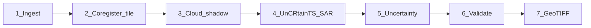

# CloudLift — 10-phase build, commit, and host

## Current repo state

Almost empty. Present today:

- [README.md](README.md) (one-line title)
- [LICENSE](LICENSE) (MIT)
- [docs/CloudLift_Engineering_Spec_HSGPC.md](docs/CloudLift_Engineering_Spec_HSGPC.md)
- [third_party/UnCRtainTS](third_party/UnCRtainTS) — git submodule already initialized (`UNCRTAINTS` in `model/src/backbones/uncrtaints.py`)

Everything else in Section 5 of the agent prompt must be created. Until real Bhoonidhi scenes and pretrained `.pth.tar` weights are supplied, **all tests, training smokes, the console, and the public demo run on a labelled synthetic fixture**. Never fabricate metrics.

## Governing constraints (do not deviate)

- **Phases in order.** Finish a phase, run its checks (`pytest` + ruff/mypy as they come online), report, then continue. Do not skip.
- **Stack is frozen:** Python 3.12, PyTorch cu124, Lightning, Rasterio/GDAL, OmniCloudMask + in-repo fallback, FastAPI, Gradio, UnCRtainTS wrapped not forked.
- **Hardware:** 256×256 tiles, batch 1, AMP, grad checkpointing, `input_t=2`, `num_workers≤4`. CPU fallback for tests and Spaces.
- **Determinism:** `set_determinism(seed)` everywhere; single forward pass; no MC-dropout / ensembles / stochastic sampling.
- **Honest core:** thick cloud is recovered from SAR + time, not invented; every pixel gets an uncertainty band.
- **Wrap UnCRtainTS via `sys.path`** into `third_party/UnCRtainTS/model`. Do **not** `pip install -r` that repo’s pins (`numpy~=1.18`). Import `UNCRTAINTS` only.

## Pipeline (must match exactly)

**Tensor contract for the adapter** (from the vendored model):

- UnCRtainTS `forward(input, batch_positions)` expects `[B, T, C, H, W]`, dates `[B, T]`.
- Upstream S2+S1: `C=15` = SAR(2) concatenated with S2(13); output `[B, 1, 26, H, W]` (13 mean + 13 var, `covmode=diag`).
- CloudLift: `C=5` = SAR(2) ∥ LISS-IV `[G, R, NIR]`; output 3 mean + 3 var.
- Adapter replaces the first conv (`input_dim=5`) and output head (`out_conv` for 3+3). If pretrained 13-band weights exist, copy S2 Green/Red/NIR filters (B3/B4/B8) into the new 3 optical slots and average remaining pretrained filters for leftover channels; new variance head init as in the original. If weights are missing, load a **tiny random-init** net and log a loud “NOT TRAINED” warning.

## Phase plan (implement in this order)

### Phase 1 — Scaffold and environment

Create the exact tree from the spec: `cloudlift/` package, `configs/`, `scripts/`, `tests/`, `docker/`, `AGENT_PROMPT.md` (the build prompt you pasted), `pyproject.toml` (`requires-python = ">=3.12,<3.13"`, script `cloudlift = cloudlift.cli:main`), `environment.yml` (conda-forge `python=3.12`, `gdal`, `rasterio`), `requirements.txt` (Lightning, torchmetrics, FastAPI, Gradio, `gradio_imageslider`, pydantic-settings, albumentations, opencv-python-headless, scikit-image, opensimplex, shapely, pyyaml, omnicloudmask, ruff, mypy, pytest, httpx, pre-commit — **torch installed separately**), `.gitignore` (`data/`, `cache/`, `results/`, `.env`, `.venv`), `.env.example`, `.pre-commit-config.yaml`.

- [cloudlift/determinism.py](cloudlift/determinism.py): `set_determinism(seed)` as specified.
- [cloudlift/cli.py](cloudlift/cli.py): start with `env-check` (Python, torch, CUDA, GPU name, VRAM, GDAL/Rasterio).
- [scripts/setup_windows.ps1](scripts/setup_windows.ps1) / [scripts/setup_linux.sh](scripts/setup_linux.sh): conda env → cu124 torch → requirements → `git submodule update --init`.
- Confirm `.gitmodules` points at `https://github.com/PatrickTUM/UnCRtainTS`.

**Checks:** `cloudlift env-check`; placeholder pytest; ruff + mypy clean on `cloudlift/`.

### Phase 2 — Data I/O and AOI

- [cloudlift/io/geotiff.py](cloudlift/io/geotiff.py): round-trip CRS, transform, nodata, band descriptions (`Green`, `Red`, `NIR`, `uncertainty`).
- [cloudlift/io/aoi.py](cloudlift/io/aoi.py): bbox / point+radius / Bhoonidhi tile ID → shapely + CRS.
- [cloudlift/io/sources.py](cloudlift/io/sources.py): `DataSource` ABC, `LocalFolderSource` (documented folder convention under `data/raw/`), `SyntheticSource`.
- [scripts/make_fixtures.py](scripts/make_fixtures.py): deterministic 1024×1024 3-band + 2-pol SAR + clean reference + mask GeoTIFFs, labelled synthetic.

**Checks:** write→read exact; AOI three forms; same seed → same fixture hash.

### Phase 3 — Preprocessing

- [cloudlift/preprocess/coregister.py](cloudlift/preprocess/coregister.py): Rasterio `reproject` onto LISS-IV grid (bilinear continuous, nearest masks) + `skimage.registration.phase_cross_correlation` refine; report residual px.
- [cloudlift/preprocess/tiling.py](cloudlift/preprocess/tiling.py): 256 px tiles, 32 px overlap, feathered untile.
- [cloudlift/preprocess/cloudmask.py](cloudlift/preprocess/cloudmask.py): OmniCloudMask wrapper; deterministic threshold+morphology fallback.
- [cloudlift/preprocess/synthetic_clouds.py](cloudlift/preprocess/synthetic_clouds.py): OpenSimplex alpha + shifted/darkened/blurred shadow → `(cloudy, mask, clean)`.

**Checks:** synthetic shift recovered within 0.25 px; tile→untile max abs error `< 1e-6` without blending; cloud fraction ±5% of requested; seeded clouds reproducible.

### Phase 4 — Model wrapper and adapter

- [cloudlift/model/adapter.py](cloudlift/model/adapter.py): layout `[B, T, 5, H, W]` (SAR∥G/R/NIR) × `input_t`; first-conv / head surgery as above.
- [cloudlift/model/uncrtaints_wrapper.py](cloudlift/model/uncrtaints_wrapper.py): `load(weights_path | None)` → `forward` → `(recon[B,3,H,W], sigma[B,3,H,W] or [B,1,H,W])`. Tiny config for tests if no weights.
- [cloudlift/model/losses.py](cloudlift/model/losses.py): L1 + SSIM + numerically stable SAM + heteroscedastic NLL; config weights; optional cloud-pixel upweight.

**Checks:** shapes; 256×256 batch-1 AMP forward peak VRAM on CUDA when available (skip otherwise); SAM(identical)=0 and scale-invariant; backward runs.

### Phase 5 — Training (fine-tune)

- [cloudlift/model/datamodule.py](cloudlift/model/datamodule.py): cached tiles + on-the-fly synthetic clouds (seeded per index); Albumentations **geometric only** (flip/rot90), no colour jitter.
- [cloudlift/model/lit_module.py](cloudlift/model/lit_module.py): combined loss, AdamW, LR `1e-3`, exp decay `0.8`/epoch, val PSNR/SSIM/SAM.
- [configs/train_laptop.yaml](configs/train_laptop.yaml) / [configs/train_cloud.yaml](configs/train_cloud.yaml) as specified.
- Preprocess-once cache at `cache/<preproc_version>/`.
- `cloudlift train --config ...` → `results/<run>/`.

**Checks:** 2-epoch smoke on synthetic fixture on CPU (and GPU if present) without OOM; loss decreases; checkpoint reload → identical val metrics.

### Phase 6 — Evaluation

- [cloudlift/eval/metrics.py](cloudlift/eval/metrics.py): PSNR, per-band+mean SSIM, SAM°, RMSE, NDVI R²/RMSE **over cloud-masked pixels**, ECE for uncertainty. Identical images: PSNR=inf handled, SSIM=1, SAM=0.
- [cloudlift/eval/report.py](cloudlift/eval/report.py): `eval.json` + `eval.md` + PNG panels (cloudy | recon | reference | uncertainty | NDVI diff). Real-scene mode: qualitative + NDVI-consistency only when no clean reference.

**Checks:** hand-computed tiny arrays; report files valid.

### Phase 7 — End-to-end pipeline and export

- [cloudlift/pipeline.py](cloudlift/pipeline.py): `run(scene, aoi, config) -> Result` through all 7 stages; per-stage timing.
- Analysis-ready GeoTIFF: bands `Green, Red, NIR, uncertainty`, original CRS/transform, LZW/DEFLATE, internal tiling, overviews, nodata, tags (model version, weights hash, config hash, seed, source IDs, timestamp, inferred pixel fraction). Where SAR is missing, uncertainty = max.
- CLI: `infer`, `export`, `batch --aoi-list file.csv` (resumable via config hash).

**Checks:** synthetic E2E; Rasterio opens output; `test_determinism.py` golden SHA-256 of reconstruction arrays; batch skip-if-exists.

### Phase 8 — FastAPI

[cloudlift/service/api.py](cloudlift/service/api.py): `GET /health`, `POST /reconstruct` → job id, `GET /jobs/{id}` (stages 1–7), `GET /export/{id}`. Sequential single worker. Idempotency-Key. Cache key `(input hash, model version, config hash)` — cache hit still creates a job record; never serve a cached result for a different input hash.

**Checks:** TestClient: health, lifecycle, idempotent retry, valid GeoTIFF export, wrong hash miss.

### Phase 9 — Gradio operator console

[cloudlift/ui/console.py](cloudlift/ui/console.py) matching the spec wireframe (chrome `#0C121D`, panel `#151E2D`, teal `#12B09C`, amber `#EF9F27`, red `#E24B4A`, text `#E7EEF6`):

- Status bar, left rail (AOI any location, EOS-04 SAR, Bhoonidhi compliance, cloud %), centre `gradio_imageslider` + Initiate / Reset / Export (export enabled only after a run), right rail 6-stage progress + confidence overlay + metric tiles that show **computed values or `—`**, bottom batch queue.
- [scripts/bake_demo.py](scripts/bake_demo.py): 3–4 hero scenes into `cache/demo/` so the demo works offline/CPU.

**Checks:** `python -m cloudlift.ui.console` on `:7860`; synthetic run updates panels; export GeoTIFF; overlay toggle.

PS expected “comparative assessment of architectures” is **documentation only** (MODEL_CARD: why UnCRtainTS vs GAN/diffusion — determinism + uncertainty; no second model trained). Matches the spec’s single-path rule.

### Phase 10 — Packaging, docs, CI

- [docker/Dockerfile.gpu](docker/Dockerfile.gpu) (PyTorch CUDA runtime) and [docker/Dockerfile.cpu](docker/Dockerfile.cpu); [docker-compose.yml](docker-compose.yml) services `api` + `console`; GPU via `--gpus all`.
- [README.md](README.md): honest-core statement, Windows/Linux setup, `data/raw/` convention, every CLI example, laptop vs cloud profiles, CUDA 13.2 + cu124 / GDAL / OOM troubleshooting. **No fabricated numbers.**
- [MODEL_CARD.md](MODEL_CARD.md): intended use, I/O, synthetic + SEN12MS-CR-TS pretrain, eval protocol, limitations (S2→LISS-IV domain gap, thick-cloud GT, SAR speckle), determinism, in-country data residency.
- [.github/workflows/ci.yml](.github/workflows/ci.yml): ruff, mypy, pytest on CPU with synthetic fixture.

**Checks:** images build; `docker compose up` serves API + console; pytest green on CPU.

## Git: commit and push `main`

After all phase checks pass (user explicitly requested this):

1. Inspect remotes/`gh`; if no origin, `gh repo create` (private unless you already have a public hackathon remote).
2. One (or a few logical) commit(s) on `main` — message focused on why: CloudLift PS-2 prototype, UnCRtainTS + SAR/temporal reconstruction, synthetic-fixture path.
3. Do **not** commit `.env`, `data/`, `cache/` (except what bake produces inside images), weights, or secrets.
4. `git push -u origin main`.

## Hosting (your choice: Docker + Hugging Face Spaces)

**Local (Tier 0):** `docker compose up` → FastAPI + Gradio on the laptop; GPU if `--gpus all`.

**Public demo:** Hugging Face Space using **Docker SDK** (needed for GDAL/Rasterio), based on `docker/Dockerfile.cpu`:

- On container start, run `make_fixtures` / `bake_demo` if `cache/demo/` is empty so the Space is self-contained.
- Gradio on port 7860 is the public surface; FastAPI can stay internal or omitted on Spaces to fit CPU RAM.
- Space README states clearly: **synthetic demo / untrained tiny weights unless checkpoints are mounted**; no invented metrics.
- Deploy with `huggingface_hub` / `hf` CLI if `HF_TOKEN` is available; otherwise print the exact commands for you to run.

## Out of scope until you supply them

- Real LISS-IV / EOS-04 / CartoDEM in `data/raw/`
- SEN12MS-CR-TS pretrained `checkpoints/*.pth.tar`
- Full A100 fine-tune (code + `train_cloud.yaml` will be ready)

Every report after a phase will list files, commands, pass/fail checks, defaults chosen, and blockers.