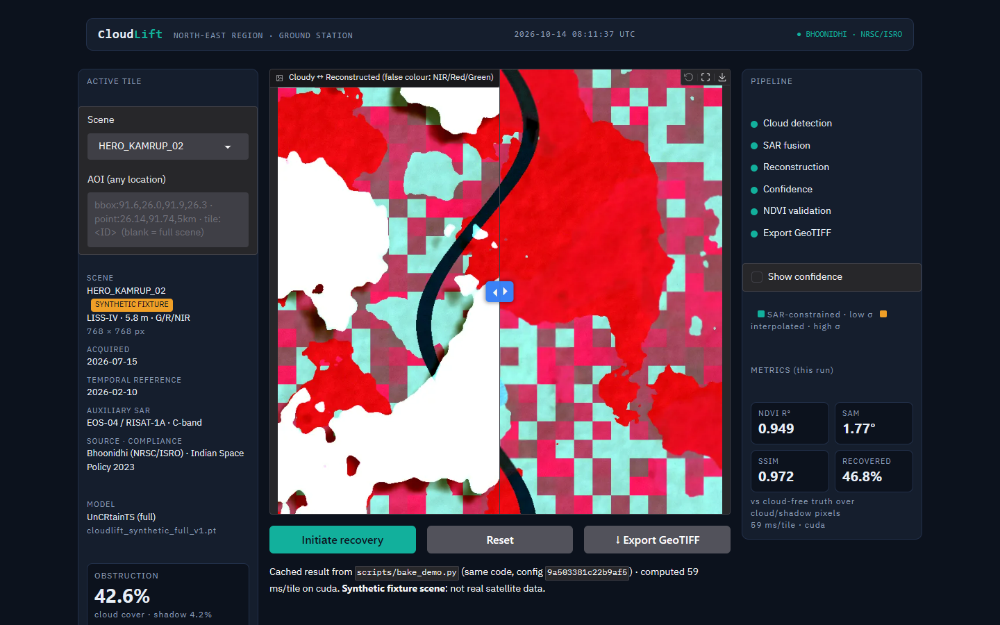

# CloudLift

**Generative AI cloud removal and surface reconstruction for LISS-IV, and any optical imagery with Green, Red and NIR bands.**

CloudLift removes cloud and cloud shadow from **LISS-IV** scenes (ResourceSat-2/2A, 5.8 m, Green/Red/NIR) and writes
**analysis-ready, cloud-free GeoTIFFs**. It fills the hidden surface by combining three sources of evidence:

* the cloudy pass itself (everything that is still visible),
* **C-band SAR** (EOS-04 / RISAT-1A), which sees through cloud, and
* an **earlier cloud-free LISS-IV pass** of the same area,

using an adapted [UnCRtainTS](https://github.com/PatrickTUM/UnCRtainTS) network. Every reconstructed pixel also gets a
**per-pixel uncertainty** (σ) value, so you know which pixels to trust.

> **Honest core.** Clear pixels are passed through untouched; only cloud/shadow pixels are replaced. Each replaced pixel
> carries the model's own uncertainty (set to 1.0 where no SAR was available). Inference is one deterministic forward pass,
> so the same input always gives byte-identical output. Metrics on screen and in reports are computed by the pipeline,
> never typed in.



## Try it

| Option | What you need | How |
|---|---|---|
| **Online** | a browser | https://huggingface.co/spaces/gurjasgandhi76/cloudlift: pick a demo scene and press **Initiate recovery**, or upload your own GeoTIFFs under **Use your own scene** |
| **Local app** | Python 3.12 (any OS, GPU optional) | see [Quickstart](#quickstart), then `cloudlift console` → http://localhost:7860 |
| **Docker** | Docker | `docker compose up --build` → console http://localhost:7860, API http://localhost:8000/docs |

A walkthrough with screenshots of every step and a full screen recording is in
[`app_screenshots_screen_recording/`](app_screenshots_screen_recording/).

## Quickstart

CloudLift runs on **Windows, Linux, macOS and WSL2**, with or without an NVIDIA GPU. The setup scripts detect your hardware:
CUDA wheels if `nvidia-smi` is present, CPU wheels otherwise (always CPU on macOS).

**Windows (PowerShell)**

```powershell
git clone --recurse-submodules https://github.com/Gurjas2112/CloudLift.git
cd CloudLift
powershell -ExecutionPolicy Bypass -File scripts\setup_windows.ps1      # add -Cpu to force CPU wheels
.venv\Scripts\Activate.ps1
cloudlift env-check
cloudlift console
```

**Linux / macOS / WSL2**

```bash
git clone --recurse-submodules https://github.com/Gurjas2112/CloudLift.git && cd CloudLift
bash scripts/setup_unix.sh            # --cpu to force CPU wheels
source .venv/bin/activate
cloudlift env-check
cloudlift console
```

On first launch the console generates four **synthetic** demo scenes (a few seconds), so it works without any downloaded
data. The GPU path uses the PyTorch **cu124** wheel, which bundles its own CUDA runtime: you only need a recent NVIDIA
driver, **not** a CUDA toolkit. The scripts use conda (`environment.yml`) if available, otherwise a plain venv
(Rasterio's pip wheels include GDAL).

Manual install: `pip install torch torchvision --index-url https://download.pytorch.org/whl/cu124` (or `/whl/cpu`), then
`pip install -r requirements-dev.txt` and `pip install --no-deps -e .`. Optional learned cloud masking:
`pip install -r requirements-cloudmask.txt`.

## Using your own data

CloudLift accepts **any optical GeoTIFF that has Green, Red and NIR bands**: LISS-IV, or other multispectral products.
Tell it where those bands are and it handles the rest.

| file | required | content |
|---|---|---|
| optical (cloudy pass) | yes | GeoTIFF with a CRS and at least Green, Red, NIR bands; integer DN or reflectance |
| SAR | optional | 2-polarisation C-band GeoTIFF (VV, VH), in dB or linear; any grid, it is reprojected |
| earlier cloud-free pass | optional | optical GeoTIFF of the same area, same band layout |

* **Band order**: 1-based (Green, Red, NIR) indexes, default `1,2,3` (LISS-IV order). For a Blue/Green/Red/NIR file use
  `2,3,4`. Extra bands are ignored.
* **Scaling**: `auto` (default) picks the divisor from the data: integers ≤ 1023 → ÷1023 (10-bit LISS-IV), ≤ 10000 →
  ÷10000 (common L2A scaling), else ÷65535; floats ≤ 1.5 are taken as reflectance. Set it explicitly if your data
  differs. The chosen bands and scale are recorded in every output (`INPUT_RADIOMETRY` tag).
* Without SAR or an earlier pass the model still runs with less evidence: uncertainty is higher (1.0 wherever SAR is
  missing under cloud).

**In the console:** open **Use your own scene**, attach the files, set band order / scaling, press **Add scene**, then
**Initiate recovery**. Files are validated (CRS, band count, band indexes) and stored locally under `data/uploads/`.
Scenes larger than 4096 × 4096 px need an AOI in the console; use the CLI or API for full scenes.

**From the command line, with plain files:**

```bash
cloudlift infer --config configs/demo.yaml --optical my_scene.tif --sar my_sar.tif --reference my_earlier.tif \
    --bands 2,3,4 --scale auto [--aoi "point:26.14,91.74,5km"]
```

**Through the API:** multipart `POST /reconstruct` with files `liss4` (the optical file), `sar`, `reference`, and optional
form fields `bands`, `scale`, `sar_units`, `acquired`, `reference_acquired`.

**On disk / from the command line:** put each scene in its own folder:

```text
data/raw/<scene_id>/
  liss4.tif       required  optical pass (LISS-IV or any GeoTIFF with Green, Red, NIR)
  sar.tif         optional  2-pol SAR (dB or linear), any grid
  reference.tif   optional  earlier cloud-free optical pass of the same area
  dem.tif         optional  terrain model
  meta.json       optional  {"acquired": "2026-07-15", "reference_acquired": "2026-02-10",
                             "bands": [1, 2, 3], "scale": "auto", "sar_units": "db" | "linear"}
```

`liss4.tif` is the optical pass of any sensor (the name is historical). SAR is converted to `(dB + 25) / 25`.
`<scene_id>` doubles as the AOI tile ID (`tile:<scene_id>`). Indian users: LISS-IV and EOS-04 data are available from
[Bhoonidhi (NRSC/ISRO)](https://bhoonidhi.nrsc.gov.in); download them yourself (CloudLift never scrapes or logs in) and
keep them in-country as the Indian Space Policy 2023 requires.

**Areas of interest** can be given in any of three forms: `bbox:minlon,minlat,maxlon,maxlat` (optionally `@EPSG:xxxx`),
`point:lat,lon,5km` (or `500m`), or `tile:<scene_id>`.

## What you get

For each run, in `results/<run_id>/`:

* `<run_id>_cloudfree.tif`: 4-band float32 GeoTIFF **Green, Red, NIR, uncertainty**, with the original CRS and transform,
  DEFLATE compression, 256 px internal tiles, overviews and nodata `-9999`. Tags record `MODEL_VERSION`, `WEIGHTS_HASH`,
  `CONFIG_HASH`, `INPUT_HASH`, `SEED`, `SOURCE_SCENE_IDS`, `PROCESSING_TIMESTAMP`, `INFERRED_PIXEL_FRACTION`,
  `MODEL_TRAINED` and `SYNTHETIC`.
* `<run_id>_mask.tif`: 0 clear, 1 cloud, 2 shadow.
* `eval.json` / `eval.md` / `panels.png`: metrics and a cloudy | reconstructed | reference | uncertainty | NDVI-difference
  panel. With a cloud-free truth available, full-reference metrics are reported over the cloud/shadow pixels. With real
  scenes (no truth under cloud), only NDVI consistency against the earlier pass is reported, and it is labelled as such.

## How it works

```text
1 Ingest → 2 Co-register & tile → 3 Detect cloud + shadow → 4 Reconstruct (UnCRtainTS, SAR-fused)
        → 5 Per-pixel uncertainty → 6 Validate (PSNR/SSIM/SAM/NDVI) → 7 Export analysis-ready GeoTIFF
```

| Stage | Implementation |
|---|---|
| 1 Ingest | local folder or upload; optional AOI crop |
| 2 Co-register | Rasterio reprojection of SAR/reference/DEM onto the LISS-IV grid; sub-pixel phase-correlation alignment of the earlier pass (residual reported) |
| 3 Cloud + shadow | deterministic multi-temporal threshold + morphology baseline, or OmniCloudMask if installed |
| 4 Reconstruct | UnCRtainTS on 256 px tiles with 32 px overlap and feathered blending; input per time step = (VV, VH, G, R, NIR) for (earlier pass, cloudy pass); clear tiles are skipped |
| 5 Uncertainty | predicted σ, 0 on observed pixels, 1.0 where SAR is missing |
| 6 Validate | metrics + panels |
| 7 Export | analysis-ready GeoTIFF + mask |

**3-band adapter.** Upstream UnCRtainTS was built for Sentinel-1 + Sentinel-2 (2 + 13 channels). The adapter keeps the
pretrained SAR filters and the Sentinel-2 B3/B4/B8 filters (= LISS-IV Green/Red/NIR) in both the first convolution and the
output head, so SEN12MS-CR-TS checkpoints can be fine-tuned directly. The upstream code is wrapped, never edited.

## Command line

| Task | Command |
|---|---|
| check the installation | `cloudlift env-check` |
| list scenes for an area | `cloudlift ingest --aoi "point:26.14,91.74,5km"` |
| reconstruct one scene folder | `cloudlift infer --config configs/demo.yaml --scene <scene_id> [--aoi ...]` |
| reconstruct your own files | `cloudlift infer --config configs/demo.yaml --optical a.tif [--sar b.tif] [--reference c.tif] [--bands 2,3,4]` |
| batch over many areas (resumable) | `cloudlift batch --aoi-list aois.csv` (CSV columns `aoi[,scene_id]`; finished work is skipped) |
| copy a result GeoTIFF | `cloudlift export --run <run_id> --out exports/scene.tif` |
| build the training tile cache | `cloudlift prep --source local` |
| train / fine-tune | `cloudlift train --config configs/train_small_gpu.yaml --source local --run my_run` |
| fine-tune from upstream weights | add `--weights checkpoints/<uncrtaints>.pth.tar` |
| evaluate a training run | `cloudlift eval --run my_run --split test` |
| web console / API | `cloudlift console` · `cloudlift serve --host 0.0.0.0 --port 8000` |

`--source auto` (default) uses `data/raw/` when it contains scenes, otherwise a labelled synthetic fixture.
`--device auto|cpu|cuda` overrides the device. All commands accept `--config` (YAML merged over `configs/default.yaml`).
Environment variables `CLOUDLIFT_DEVICE`, `CLOUDLIFT_WEIGHTS` and `CLOUDLIFT_CONFIG` work too (see `.env.example`).

### Training profiles

| profile | hardware | tile / batch / accumulation | precision | model |
|---|---|---|---|---|
| `configs/train_cpu.yaml` | no GPU | 128 / 4 / 1 | fp32 | tiny |
| `configs/train_small_gpu.yaml` | 6–8 GB GPU | 256 / 1 / 8, gradient checkpointing | fp16 mixed | full |
| `configs/train_large_gpu.yaml` | 24 GB+ GPU | 256 (512 optional) / 8 / 1 | bf16 mixed | full |

Training reads a preprocess-once tile cache (`cache/<preproc_version>/`) and composites synthetic clouds over
cloud-free tiles on the fly, seeded per tile. Augmentation is geometric only (flips/rotations), never colour, to keep
spectra intact.

### Service API

`GET /health` · `POST /reconstruct` (JSON `{"scene_id", "aoi", "source"}` or multipart upload of `liss4`, `sar`,
`reference` [+ `bands`, `scale`, `meta` JSON]) → `job_id` · `GET /jobs/{id}` (stage 1–7 progress) · `GET /export/{id}` (GeoTIFF).
Interactive docs at `/docs`. Jobs run one at a time. Sending the same `Idempotency-Key` returns the same job. Results are
cached by (input hash, model + weights version, config hash), so a different input never receives a cached result.

### Docker and hosting

```bash
docker compose up --build                                                    # CPU
docker compose -f docker-compose.yml -f docker-compose.gpu.yml up --build   # NVIDIA GPU (Container Toolkit / WSL2)
```

`docker/Dockerfile.cpu` (python:3.12-slim + CPU torch) bakes the demo scenes at build time. `docker/Dockerfile.gpu` uses
`nvidia/cuda:12.6.3-runtime-ubuntu24.04` + the cu124 wheel. To publish your own copy of the console as a Hugging Face
Docker Space, run `hf auth login` and then `python scripts/deploy_hf_space.py --repo <user>/<space>`. Docker Spaces on free
CPU hardware require a Hugging Face PRO account.

## Results

These numbers come from `cloudlift eval --config configs/demo.yaml --run demo_full_synthetic --split test --n-scenes 3`, on
**3 held-out synthetic test scenes** (1024² px, 31–51 % cloud + shadow). **They are not real LISS-IV results.** The shipped
weights (`assets/weights/cloudlift_synthetic_full_v1.pt`) are the full UnCRtainTS trained on synthetic scenes only, with
`configs/train_small_gpu.yaml` on a 6 GB laptop GPU: best validation checkpoint (epoch 9) of a run stopped in epoch 11.

| over cloud + shadow pixels (mean of 3 scenes) | PSNR (dB) | SSIM | SAM (°) | NDVI R² | NDVI RMSE |
|---|---|---|---|---|---|
| cloudy input (no reconstruction) | 5.60 | — | 25.93 | −2.965 | 0.561 |
| temporal fill (copy the co-registered earlier pass) | **41.60** | **0.986** | **1.25** | **0.983** | **0.037** |
| **CloudLift UnCRtainTS** (SAR + earlier pass + cloudy pass) | 41.01 | 0.977 | 1.47 | 0.961 | 0.056 |

Whole scene, including untouched clear pixels: PSNR 44.51 dB, SSIM 0.989, SAM 0.67°. Uncertainty calibration: coverage
ECE 0.073, UCE 0.0020. Cloud-mask IoU 0.938. Speed: **78 ms per 256² tile** on an RTX 3060 Laptop GPU (fp16) and about
**1.1 s per tile** on a laptop CPU.

**Reading this honestly.** In the synthetic data the earlier pass differs from the truth only by a mild crop-vigour change,
so copying it is already near-optimal, and the network does not beat it there. The network adds calibrated σ and
SAR-driven evidence for when the earlier pass is outdated, missing or the land has changed (floods, harvest). Those cases
need real data to evaluate. See [`MODEL_CARD.md`](MODEL_CARD.md) for intended use and limitations.

## Reproducibility

`cloudlift.determinism.set_determinism(seed)` seeds Python/NumPy/torch, sets `CUBLAS_WORKSPACE_CONFIG`, cuDNN deterministic
mode and `torch.use_deterministic_algorithms(True)`. `tests/test_determinism.py` runs the pipeline twice and requires
identical SHA-256 hashes. It also compares against recorded golden hashes where the environment matches (hashes are
device- and library-specific). CUDA *training* relaxes this to warn-only, because one UnCRtainTS layer
(`AdaptiveMaxPool2d`) has no deterministic CUDA backward pass. Inference is always strict.

## Troubleshooting

* **`cuda: False` although you have an NVIDIA GPU**: install the cu124 wheel from the PyTorch index (not plain
  `pip install torch`) and update your NVIDIA driver; then run `cloudlift env-check`.
* **GDAL/Rasterio import errors on Windows**: use a clean venv with the PyPI Rasterio wheel, or conda-forge
  `gdal rasterio`. Do not mix in OSGeo4W GDAL DLLs on `PATH`.
* **CUDA out of memory**: use `configs/train_small_gpu.yaml`; increase `accumulate_grad_batches`, not `batch_size`.
* **Upload rejected**: the file needs a coordinate reference system, at least 3 bands for the optical files (2 for SAR),
  and band indexes within the file's band count.
* **Reconstruction looks too dark / saturated**: the scaling guess was wrong; set **Scaling** (or `--scale`) explicitly.
* **`UnicodeEncodeError` in your own scripts on Windows**: set `PYTHONUTF8=1`.
* **`UnCRtainTS submodule missing`**: `git submodule update --init --recursive`.

## Development

```bash
pip install -r requirements-dev.txt && pre-commit install
ruff check cloudlift tests scripts && ruff format --check cloudlift tests scripts
mypy                      # strict on cloudlift/
pytest                    # CPU; GPU-only tests skip automatically
```

CI (`.github/workflows/ci.yml`) runs ruff, mypy and pytest on CPU.

## Repository layout

```text
cloudlift/              package: io, preprocess, model, eval, service (FastAPI), ui (Gradio), pipeline.py, cli.py
configs/                default, demo, and training profiles (cpu / small_gpu / large_gpu)
scripts/                setup_windows.ps1, setup_unix.sh, make_fixtures.py, bake_demo.py, deploy_hf_space.py,
                        capture_walkthrough.py (regenerates the screenshots + recording)
tests/                  pytest suite (synthetic fixtures)
docker/, docker-compose*.yml, deploy/hf_space/     container and Space packaging
assets/weights/         shipped demo weights (synthetic-trained)
app_screenshots_screen_recording/   step-by-step screenshots and a full screen recording
third_party/UnCRtainTS  upstream model (git submodule)
MODEL_CARD.md           intended use, training data, evaluation, limitations
```

## Licence

MIT (see `LICENSE`). UnCRtainTS © Patrick Ebel et al., MIT-licensed upstream.
