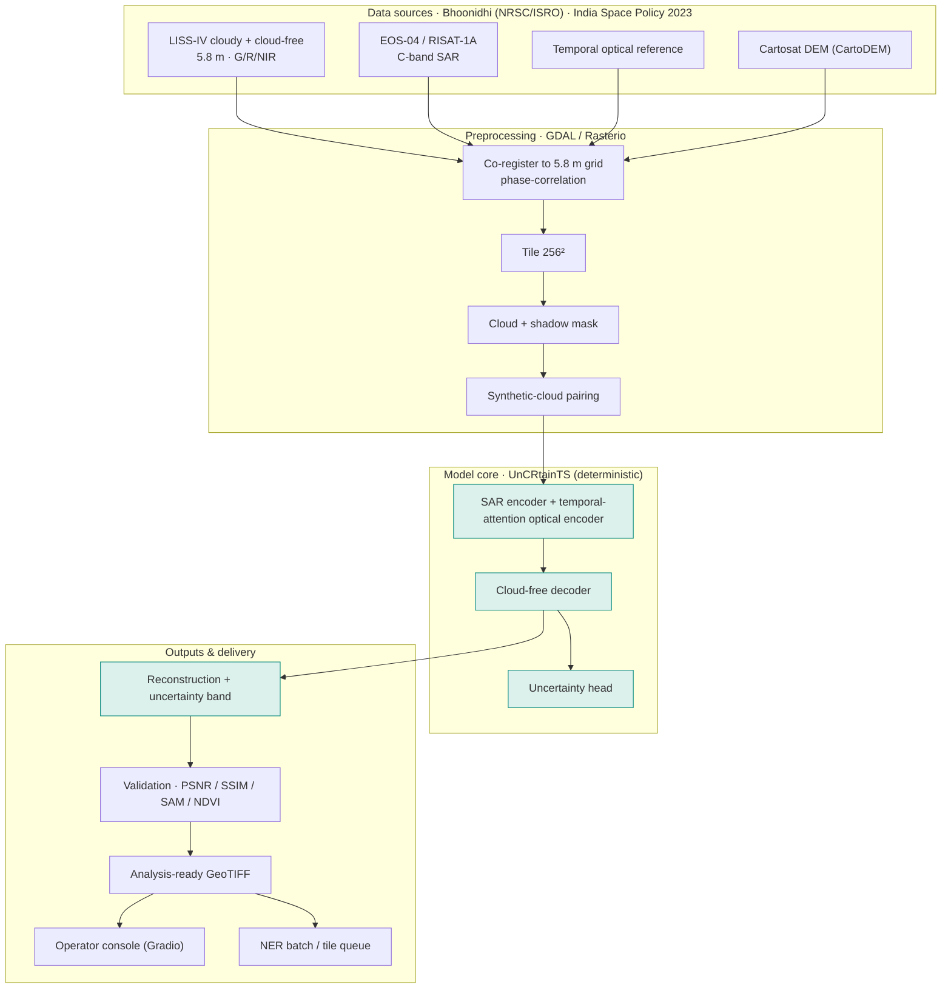
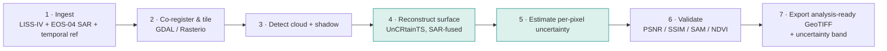
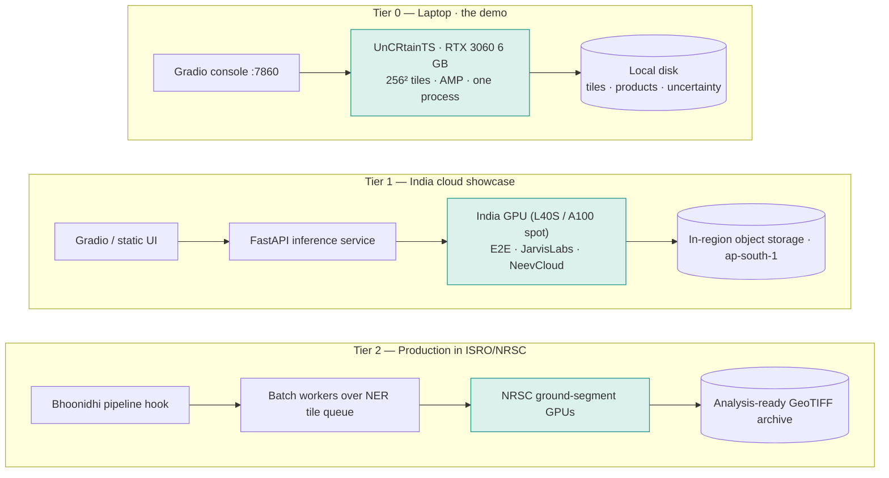

# CloudLift — Generative AI Cloud Removal & Reconstruction for LISS-IV Imagery

### Engineering, platform and setup specification — tuned for your machine

**Bharatiya Antariksh Hackathon 2026 · PS-2 · Generative AI / Remote Sensing** — build edition, v1.0

Target: analysis-ready, cloud-free LISS-IV products over the North-Eastern Region, sourced and delivered under the Indian Space Policy 2023.

> This document is written **for one specific machine** — the `HSGPC` laptop (RTX 3060 Laptop 6 GB, i7-11800H, 16 GB RAM, Windows 11, CUDA 13.2, Python 3.12.0). Every "can I run this locally?" question is answered against that exact hardware. Where the laptop is enough, it says so; where it is not, it says what to rent and why. It reuses the architecture, model choice, data sources and cost model established for CloudLift and makes them concrete and runnable here.

## How to read this document

This is a **single recommended path**, not a menu. Each layer has one pick with the reason it was chosen. Parts I–II say what to build and why; Part III is the platform around the model; Part IV is the build; **Part V is the one that matters for your laptop** — compatibility verdict, what runs local vs. cloud, and copy-paste installation for Windows 11 + CUDA 13.2. When the model and the platform compete for hours, the model wins.

> **On the honest core.** CloudLift's whole credibility rests on one claim: under thick cloud there is no optical signal, so the surface is *recovered from radar and time*, not invented. SAR (which sees through cloud) plus a temporal reference is the real signal; the generative model refines it and reports a per-pixel uncertainty. Keep that sentence central — it is also what separates this from an optical inpainter.

## Contents

**Part I — Position**
- [1. Scope and what the PS actually grades](#1-scope-and-what-the-ps-actually-grades)
- [2. What is solved, and what is not](#2-what-is-solved-and-what-is-not)
- [3. Users and scenarios](#3-users-and-scenarios)

**Part II — System**
- [4. System architecture](#4-system-architecture)
- [5. End-to-end reconstruction flow](#5-end-to-end-reconstruction-flow)
- [6. Model and algorithm pipeline](#6-model-and-algorithm-pipeline)

**Part III — Platform**
- [7. Data architecture, sources and compliance](#7-data-architecture-sources-and-compliance)
- [8. Deployment and scaling](#8-deployment-and-scaling)
- [9. Verification and validation](#9-verification-and-validation)

**Part IV — Build**
- [10. Tool register](#10-tool-register)
- [11. Interface design — the operator console](#11-interface-design--the-operator-console)
- [12. Prototype build plan](#12-prototype-build-plan)

**Part V — Setup on your machine**
- [13. Your machine — compatibility verdict](#13-your-machine--compatibility-verdict)
- [14. The 6 GB VRAM question — local vs. cloud](#14-the-6-gb-vram-question--local-vs-cloud)
- [15. Installation (Windows 11 · CUDA 13.2 · Python 3.12)](#15-installation-windows-11--cuda-132--python-312)
- [16. Configuration](#16-configuration)
- [17. Running it — inference, fine-tune, console](#17-running-it--inference-fine-tune-console)
- [18. Testing and caching](#18-testing-and-caching)
- [19. Risk register](#19-risk-register)

---

## 1. Scope and what the PS actually grades

PS-2 asks for a **Generative AI framework** that removes cloud and cloud-shadow from LISS-IV imagery and reconstructs the hidden surface while preserving spatial structure and spectral consistency, with quantitative and qualitative evaluation and a scalable operational workflow.

Read backwards, that gives five things the build must produce, and everything else is cut:

| Element | Verdict | Reason |
|---|---|---|
| Deterministic reconstruction model (SAR + temporal fusion) | ✅ **build** | The graded core. Deterministic so a reviewer can reproduce every pixel. |
| Per-pixel uncertainty output | ✅ **build** | Turns "are you hallucinating?" into a visible, defensible answer. Analysis-ready quality flag. |
| Evaluation harness (PSNR / SSIM / SAM / NDVI) | ✅ **build** | The PS explicitly asks for quantitative *and* qualitative assessment. |
| Synthetic-cloud paired-data generator | ✅ **build** | The only way to get aligned cloudy/clear LISS-IV pairs for supervised training. |
| Operator console + GeoTIFF export | ✅ **build** | The "analysis-ready product" and the "operational workflow" the PS names. |
| Multi-user accounts, billing, generic web dashboard | ❌ **cut** | Zero PS value; this is an internal/operational tool, not a consumer app. |
| Training a cloud-removal model from scratch | ❌ **cut** | Months of compute. Transfer-learn from a pretrained model instead (Section 6). |

> **The governing trade.** A polished UI around a model that invents ground loses to a plain UI around a model that recovers it honestly and says where it was unsure.

---

## 2. What is solved, and what is not

**Solved elsewhere.** Cloud removal on Sentinel-2 is an active, well-served research area — SEN12MS-CR / SEN12MS-CR-TS provide paired SAR-optical data, and models like DSen2-CR, GLF-CR, DiffCR and UnCRtainTS publish strong results on it. Thin-haze correction is near-commodity.

**Not solved for this problem.**

| Gap | Why it is open | Our answer |
|---|---|---|
| LISS-IV specifically | 5.8 m, three bands (Green/Red/NIR, **no blue**); public CR models target Sentinel-2's 13 bands. | A 3-band input adapter + fine-tuning on LISS-IV. |
| Honest thick-cloud recovery | Optical-only inpainters hallucinate ground under opaque cloud. | SAR + temporal fusion as the signal; generative refinement on top; uncertainty on every pixel. |
| India-sovereign, reproducible pipeline | Foreign data/cloud raises compliance and reproducibility concerns for operational use. | Bhoonidhi (NRSC/ISRO) sources + deterministic model + in-country compute. |
| Analysis-ready, not just pretty | PSNR alone does not prove downstream usability. | NDVI-agreement and spectral-angle validation as headline metrics. |

---

## 3. Users and scenarios

**Scenario A — disaster response (the hero).** The Majuli / Brahmaputra floods, monsoon. An analyst needs flood extent from a LISS-IV pass that is 70%+ cloud-covered. CloudLift reconstructs the scene from EOS-04 SAR plus a pre-flood reference, flags the inferred pixels, and exports an analysis-ready GeoTIFF the flood-mapping workflow can use the same day.

**Scenario B — routine LULC / environmental monitoring.** A tile that has been cloud-blocked for weeks is recovered so the time series is continuous enough for land-use change detection.

**Scenario C — archive reprocessing.** Historic cloud-contaminated LISS-IV tiles over the NER are batch-reconstructed to raise the usable fraction of the archive.

---

## 4. System architecture



*Figure 1 — The same model runs for a single tile in the console and for a batch over the region. The branded path is the honest one: SAR and time enter the encoder; the decoder reconstructs; the uncertainty head labels every pixel measured-vs-inferred.*

---

## 5. End-to-end reconstruction flow



*Figure 2 — Seven stages, deterministic end to end. Steps 4–5 are the model; the rest is geospatial plumbing and validation.*

---

## 6. Model and algorithm pipeline

**One architecture, chosen to match the PS.** The PS asks to "leverage spatial, spectral and temporal information" via "multi-modal fusion using Sentinel-1 SAR / temporal references." That points unambiguously at a multi-modal, multi-temporal model. The pick is **UnCRtainTS** (`github.com/PatrickTUM/UnCRtainTS`): a transformer that encodes an optical time-series with temporal attention, fuses SAR, decodes a cloud-free image, and emits a per-pixel uncertainty — deterministic (a single forward pass, not a stochastic sampler), so the same input always gives the same output.

**Why not diffusion.** Diffusion CR (e.g. DiffCR) can edge raw PSNR, but it samples from noise and is non-reproducible — the wrong property for an operational ISRO product that must be auditable. UnCRtainTS trades a fraction of a dB for determinism and free uncertainty. That is the correct trade here.

**Transfer-learning path (this is what makes it feasible on a laptop):**

1. Start from UnCRtainTS weights pretrained on **SEN12MS-CR-TS** (open, Sentinel-1 + Sentinel-2 time-series).
2. Swap the input convolution to **3 bands (G/R/NIR)** + SAR channels — LISS-IV has no blue band; this adapter is the one piece of surgery you must do (Section 16).
3. **Fine-tune** on LISS-IV + synthetic-cloud pairs. Only the fine-tune runs on your data; you never train from scratch.

**Losses:** L1 for structure, SSIM for perceptual consistency, **Spectral Angle Mapper (SAM)** for spectral fidelity, and the model's native heteroscedastic (NLL) term so the uncertainty head stays calibrated.

**Synthetic-cloud pairing:** composite procedural cloud + shadow (OpenSimplex noise + a shifted darker shadow layer) onto cloud-free LISS-IV to make perfectly-aligned cloudy/clear pairs at unlimited volume. Train on synthetic; validate on *real* cloudy scenes.

---

## 7. Data architecture, sources and compliance

Everything is sourced through **Bhoonidhi (NRSC/ISRO)**, India's official EO data hub, under the **Indian Space Policy 2023** — open and regulated, with data resident in India.

| Role | Dataset | Notes |
|---|---|---|
| Primary optical | **LISS-IV** (ResourceSat-2/2A), 5.8 m, G/R/NIR | Cloudy + cloud-free scenes; draw any AOI on Bhoonidhi. |
| Through-cloud SAR | **EOS-04 / RISAT-1A**, C-band | India-owned SAR; the compliant substitute for Sentinel-1. |
| Temporal reference | prior cloud-free LISS-IV pass | T−N days, same AOI. |
| Terrain | **Cartosat DEM (CartoDEM)** | ISRO DEM; aids co-registration and shadow geometry. |
| Pretraining only | SEN12MS-CR-TS | Foreign open dataset used only to initialise weights, never as an input at inference. |

Pixels stay on the local disk / in-country object storage; the relational store (if any) holds only tile metadata and run records.

---

## 8. Deployment and scaling

Three tiers. You run Tier 0 on this laptop, you share Tier 1, you pitch Tier 2.



*Figure 3 — The same model code runs in all three tiers; only where the GPU lives changes. Production cost collapses toward the storage line when it runs on NRSC's own GPUs (see the cost PDF).*

---

## 9. Verification and validation

The PS asks for quantitative and qualitative evaluation; report three layers so a reviewer can trust it.

- **Image quality** — PSNR, SSIM (per band), RMSE. `torchmetrics`.
- **Spectral fidelity** — **SAM** (spectral angle). Proves the reconstruction did not just *look* right while wrecking the band ratios.
- **Downstream / analysis-ready** — **NDVI agreement** (R², RMSE, difference map) between reconstructed and true cloud-free, plus uncertainty-calibration error.

Validate on **held-out real cloudy scenes**, not only synthetic, and show that SAR-only-visible regions fill sensibly. Pin the evaluation split and seed so numbers are reproducible.

> Figures quoted in the pitch (e.g. NDVI R² ≈ 0.94, SAM ≈ 3.1°, SSIM ≈ 0.91) are **targets** until your own run produces them. Replace with measured values before presenting.

---

## 10. Tool register

Single pick per layer. All open-source; all installable on Windows 11.

| Layer | Pick | Why it beat the alternatives |
|---|---|---|
| Language | **Python 3.12** (you have 3.12.0) | Matches every CR repo. |
| DL framework | **PyTorch** (CUDA 12.x wheels) | UnCRtainTS is PyTorch; see the CUDA note in Section 15. |
| Training loop | **PyTorch Lightning** | Removes boilerplate; AMP + grad-checkpointing toggles that matter on 6 GB. |
| Core model | **UnCRtainTS** | Deterministic, multi-modal, uncertainty-aware (Section 6). |
| Geospatial I/O | **Rasterio + GDAL** | Reprojection, `gdalwarp`, GeoTIFF read/write. |
| Cloud masking | **OmniCloudMask** / `s2cloudless` | Don't hand-roll cloud+shadow detection. |
| Synthetic cloud | **OpenSimplex + OpenCV** | Aligned paired data, unlimited volume. |
| Augmentation | **Albumentations** | Geometric aug (careful with spectral integrity). |
| Metrics | **torchmetrics** + custom SAM/NDVI | PSNR/SSIM out of the box. |
| Demo UI | **Gradio** | Image slider + confidence toggle + map; runs locally. |
| Packaging | **Docker / WSL2** | Reproducible, scales to Tier 1/2. |
| Visual QA | **QGIS** | Eyeball alignment and outputs. |

---

## 11. Interface design — the operator console

A single-screen ground-station console (the "CloudLift" UI already specified for this project):

- **Status bar** — brand, AOI mission, live clock, `BHOONIDHI · NRSC/ISRO` link indicator.
- **Left rail** — active tile telemetry (scene, **AOI accepts any location**, acquired, auxiliary SAR = EOS-04/RISAT-1A, source · compliance) and an obstruction readout (cloud %).
- **Centre viewport** — the cloudy↔reconstructed **radar-sweep reveal** (drag divider), with `Initiate recovery`, `Reset`, and **`Export GeoTIFF`** controls.
- **Right rail** — the six-stage pipeline (Cloud detection → SAR fusion → Reconstruction → Confidence → NDVI validation → Export GeoTIFF), a **Show confidence** toggle (teal = SAR-constrained, amber = interpolated), and the metric tiles.
- **Bottom** — the NER tile queue (done / queued).

Colour semantics (keep consistent with the deck and the HTML prototype): teal `#12B09C` = recovered/trusted, amber `#EF9F27` = interpolated/uncertain, red = cloud/problem, console chrome near-black `#0C121D`.

---

## 12. Prototype build plan

Tiered so you always have something to show. Team of 3–4.

1. **Hour 0–8 · data + plumbing.** Bhoonidhi pulls, GDAL co-registration to the 5.8 m grid, tiling, synthetic-cloud generator. Unblocks everyone.
2. **Hour 0–6 · safety-net baseline.** A no-train inpainting baseline (e.g. LaMa) so a before/after exists on day one.
3. **Hour 8–28 · the model.** 3-band adapter on UnCRtainTS, fine-tune on synthetic LISS-IV pairs (cloud GPU — Section 14), export reconstruction + uncertainty.
4. **Hour 20–34 · eval + console.** Metrics pipeline (PSNR/SSIM/SAM/NDVI), Gradio console wired to cached hero scenes.
5. **Freeze at ~hour 30.** Spend the rest on the demo and pitch, not another 0.3 dB.

---

## 13. Your machine — compatibility verdict

Your `HSGPC` laptop:

| Spec | Value | Verdict for CloudLift |
|---|---|---|
| GPU | **RTX 3060 Laptop, 6 GB GDDR6** | ✅ for inference & light fine-tune at 256² tiles; ⚠️ not enough for full-scene or large-batch training — use cloud for the heavy run. |
| CPU | i7-11800H (8c/16t) | ✅ ample for GDAL/Rasterio preprocessing and tiling. |
| RAM | 16 GB (15.7 usable) | ⚠️ workable; keep dataloader workers ≤ 4 and avoid loading whole scenes into memory. |
| Storage | 598/954 GB used (~356 GB free) | ⚠️ enough for a tiled working set; keep raw scenes on an external/second drive. |
| OS | Windows 11 (26H2) | ✅ supported; WSL2 recommended for GDAL. |
| CUDA | **13.2** (driver toolkit) | ⚠️ newer than PyTorch's stable CUDA wheels — **see Section 15**, this is the one gotcha. |
| Python | 3.12.0 | ✅ matches PyTorch cu12x wheels. |

**One-line verdict:** this laptop is a capable **development and inference** machine for CloudLift and can do **small-tile fine-tuning**, but the full fine-tune/benchmark should run on a rented India GPU. The RTX 3060's 6 GB is the binding constraint, not the CPU or OS.

---

## 14. The 6 GB VRAM question — local vs. cloud

Be precise about what 6 GB can and cannot do, because guessing here wastes hackathon hours.

**Runs comfortably on your RTX 3060 (6 GB):**
- All preprocessing (GDAL/Rasterio co-registration, tiling, cloud masking, synthetic-cloud pairing) — CPU/GPU-light.
- **Inference** on 256×256 tiles with mixed precision (FP16/AMP), batch 1–2. This is enough to run the console and the hero demo entirely offline.
- **Light fine-tuning** at 256² tiles, batch 1–2, with AMP + gradient checkpointing and a short time-series length (`input_t` 2–3). Slow but real.

**Needs a rented India GPU (A100 40–80 GB, or at least an L40S/A100 via E2E Networks, JarvisLabs, NeevCloud, Cyfuture):**
- The **full fine-tune** at useful batch sizes and the **comparative benchmark** — the ~250–370 GPU-hours in the cost model. On 6 GB these would take days and risk OOM; on an A100 they are an overnight job.
- Any experiment with larger tiles (512²) or longer time-series.

**VRAM survival kit for the 3060** (apply all when training locally):
- `torch.cuda.amp` mixed precision; `batch_size=1`, accumulate gradients to simulate a larger batch.
- Gradient checkpointing on the encoder; `input_t=2`.
- 256² tiles only; `num_workers<=4`; `PYTORCH_CUDA_ALLOC_CONF=expandable_segments:True` to curb fragmentation.
- Close the browser, VS Code GPU features, and anything using the 6 GB while training.

> **Recommendation.** Develop, debug, run inference and the demo on the laptop; do the one real fine-tune and the benchmark on a rented India GPU for a few hundred rupees (see the cost PDF). This keeps data in-country and the laptop free for building the console.

---

## 15. Installation (Windows 11 · CUDA 13.2 · Python 3.12)

### The one gotcha — your CUDA 13.2 vs. PyTorch

`nvcc` reporting **CUDA 13.2** is the *toolkit/driver* version. PyTorch's stable wheels ship their **own** bundled CUDA runtime (currently cu121 / cu124 — i.e. 12.x), and your newer NVIDIA driver is backward-compatible with them. So **you do not install a separate CUDA toolkit for PyTorch** — you install a PyTorch wheel built for CUDA 12.x and it runs fine on your 13.2 driver. Do **not** try to force a 13.x build; use the official index.

### Step 1 — Python venv

```powershell
py -3.12 -m venv .venv
.\.venv\Scripts\Activate.ps1
python -m pip install --upgrade pip
```

### Step 2 — PyTorch (CUDA 12.x wheel, runs on your 13.2 driver)

```powershell
pip install torch torchvision --index-url https://download.pytorch.org/whl/cu124
python -c "import torch; print(torch.__version__, torch.cuda.is_available(), torch.cuda.get_device_name(0))"
# expect: ... True  NVIDIA GeForce RTX 3060 Laptop GPU
```

If `cuda.is_available()` is `False`, update the NVIDIA Game Ready/Studio driver and retry — do not install a CUDA toolkit.

### Step 3 — Geospatial stack (the Windows pain point)

GDAL/Rasterio wheels on native Windows can be fragile. **Preferred: WSL2 (Ubuntu)**, where `pip install rasterio` just works and GDAL is a `conda`/`apt` away. If staying on native Windows, use conda-forge:

```powershell
# Option A (recommended): inside WSL2 Ubuntu
# sudo apt update && sudo apt install -y gdal-bin libgdal-dev
# pip install rasterio gdal

# Option B: native Windows via conda-forge
conda create -n cloudlift python=3.12 -y
conda activate cloudlift
conda install -c conda-forge gdal rasterio -y
```

### Step 4 — The rest

```powershell
pip install pytorch-lightning torchmetrics albumentations opencv-python-headless numpy scikit-image opensimplex gradio folium tqdm pyyaml
pip install omnicloudmask   # or s2cloudless for Sentinel masks
```

### Step 5 — UnCRtainTS

```powershell
git clone https://github.com/PatrickTUM/UnCRtainTS.git
cd UnCRtainTS
pip install -r requirements.txt   # reconcile versions with the torch already installed
```

> Reconcile, don't overwrite: if the repo pins an older torch, keep your cu124 torch and let the other packages adapt. Confirm the CLI flag names against the current README before the runs in Section 17 — they can shift between commits.

---

## 16. Configuration

### Determinism (so every reconstruction is reproducible)

```python
import os, random, numpy as np, torch
SEED = 0
os.environ["PYTHONHASHSEED"] = str(SEED)
os.environ["CUBLAS_WORKSPACE_CONFIG"] = ":4096:8"
os.environ["PYTORCH_CUDA_ALLOC_CONF"] = "expandable_segments:True"   # helps the 6 GB card
random.seed(SEED); np.random.seed(SEED)
torch.manual_seed(SEED); torch.cuda.manual_seed_all(SEED)
torch.backends.cudnn.deterministic = True
torch.backends.cudnn.benchmark = False
torch.use_deterministic_algorithms(True)
```

Run the **single model**, not the epistemic ensemble, and never MC-dropout — both reintroduce randomness. The uncertainty head gives per-pixel error without sampling.

### LISS-IV 3-band input adapter (the one piece of surgery)

```python
# LISS-IV has G, R, NIR (no blue). Adapt the first conv and the output head.
in_channels  = 3 + 2     # G,R,NIR  +  EOS-04 SAR (2 pol)
out_channels = 3         # reconstruct G,R,NIR
input_t      = 2         # temporal length — keep small on 6 GB (2–3)
tile         = 256       # 256² tiles only on the 3060
```

### 6 GB training config (Lightning)

```python
trainer = L.Trainer(
    accelerator="gpu", devices=1, precision="16-mixed",
    accumulate_grad_batches=8,          # simulate batch 8 at batch 1
    gradient_clip_val=1.0, max_epochs=20, deterministic=True,
)
# dataloader: batch_size=1, num_workers=4, pin_memory=True
```

---

## 17. Running it — inference, fine-tune, console

```powershell
# 0) Sanity check on a SEN12MS-CR-TS sample (deterministic forward pass)
python test_reconstruct.py --experiment_name pretrained --root .\data\SEN12MSCRTS --input_t 2 --use_sar --weight_folder .\checkpoints

# 1) Build synthetic LISS-IV pairs (local, CPU/GPU-light)
python tools\make_synthetic_pairs.py --clear .\data\liss4_clear --out .\data\liss4_pairs --clouds opensimplex

# 2) Fine-tune — SMALL run fits the 3060; the FULL run goes to a rented A100
python train_reconstruct.py --experiment_name liss4_local --root .\data\liss4_pairs --input_t 2 --use_sar --batch_size 1 --lr 1e-3 --n_epochs 20

# 3) Export reconstruction + uncertainty for a scene
python test_reconstruct.py --experiment_name liss4_local --root .\data\liss4_eval --input_t 2 --use_sar --weight_folder .\results\liss4_local --export_every 1

# 4) Launch the operator console (http://localhost:7860)
python app\cloudlift_console.py
```

The console (`cloudlift_console.html` logic ported to Gradio) loads cached hero tiles so the live demo cannot crash; keep the "upload any AOI" path as the flex.

---

## 18. Testing and caching

- **Pre-bake the hero scenes.** Run the 3–4 demo tiles through the pipeline once; cache cloudy, SAR, reconstruction, uncertainty and NDVI PNGs plus the final GeoTIFF. The console serves these instantly and offline.
- **Golden-output test.** Because the model is deterministic, assert that a fixed input tile reproduces a byte-identical reconstruction hash across runs — this is your proof of reproducibility and your regression guard.
- **Metric test.** Assert PSNR/SSIM/SAM/NDVI on a tiny fixed validation set stays within tolerance of recorded values; fail CI if `threshold`/eval config changes without re-recording.
- **Preprocess-once cache.** Co-register and tile each scene once into `data/cache/`; every training epoch and the synthetic generator read from there, not from raw scenes — the i7 has the cores, the disk is the bottleneck.

---

## 19. Risk register

| Risk | Likelihood | Mitigation |
|---|---|---|
| 6 GB OOM during local fine-tune | High | 256² tiles, batch 1 + grad-accum, AMP, checkpointing, `input_t=2`; move the real run to a rented A100. |
| CUDA 13.2 vs PyTorch wheel confusion | High | Install cu124 wheel on the existing 13.2 driver — do **not** install a CUDA toolkit (Section 15). |
| GDAL/Rasterio install fails on native Windows | Medium | Use WSL2 or conda-forge, not pip-on-native-Windows. |
| Misregistration silently wrecks metrics | Medium | Phase-correlation refine per tile; eyeball in QGIS before trusting numbers. |
| Domain gap (Sentinel-2 pretrain → LISS-IV) | Medium | 3-band adapter + fine-tune + SAM loss; report it as a managed risk, not a hidden one. |
| Judging "are you hallucinating?" | Low | The confidence toggle *is* the answer — point at the amber. |
| Fabricated metrics in the pitch | Low | Mark all figures as targets until measured; never present unmeasured numbers as results. |

---

*This specification reuses the CloudLift architecture, model choice (UnCRtainTS), India-compliant data chain (Bhoonidhi / EOS-04 / Cartosat under the Indian Space Policy 2023) and cost model developed for this project, and makes them concrete for the `HSGPC` laptop. Performance figures are targets until your own validation run replaces them. Confirm external tool versions and CLI flags against their current documentation before the final build.*

CloudLift — engineering specification v1.0 · BAH 2026 · PS-2
